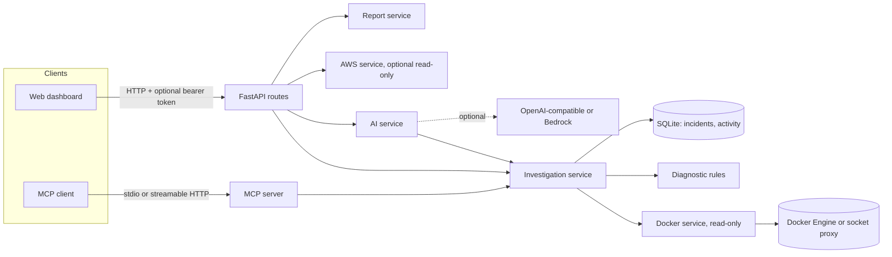

# Architecture

| Layer | Files | Responsibility |
|---|---|---|
| API | `app/api/routes.py`, `app/main.py` | Validation, auth, CORS, request limits, error mapping. No business logic. |
| Evidence | `app/services/docker_service.py` | Read-only Docker SDK calls, bounded logs, redaction, stats. Missing metrics stay `None`. |
| Rules | `app/services/diagnostic_engine.py` | 15 deterministic rules; no AI dependency. Single keyword = low confidence. |
| Orchestration | `app/services/investigation.py` | Docker evidence + rules. Shared by API, assistant and MCP. |
| AI | `app/services/ai_service.py` | Provider interface, prompt building, JSON parsing, fallback to rules. |
| Storage | `app/services/incident_service.py` | SQLite, redacted and size-bounded snapshots. |
| Reports | `app/services/report_service.py` | Markdown and JSON, redacted on export. |
| AWS | `app/services/aws_service.py` | Optional read-only boto3 calls with input validation. |
| MCP | `app/mcp/` | Tool schemas and the server. Independent of the web app. |

Design decisions that matter:

- Evidence strings come only from Docker and rules. The AI cannot add to "observed evidence".
- Logs are untrusted input: they are redacted, bounded, wrapped in `<evidence>` tags, and the system prompt says to ignore instructions inside them. The UI inserts them with `textContent`.
- Resolved status is only set through an explicit `confirm: true` request.
